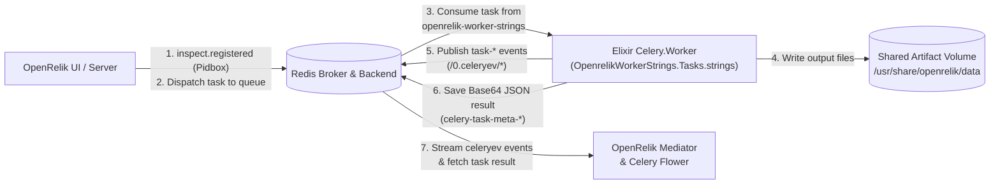

# OpenRelik Strings Worker (Elixir Reference Implementation)

An Elixir implementation of [`openrelik-worker-strings`](https://github.com/openrelik/openrelik-workers/tree/main/workers/openrelik-worker-strings) built on the Elixir [`celery`](https://hex.pm/packages/celery), [`kombu`](https://hex.pm/packages/kombu), and [`openrelik_worker_common`](https://hex.pm/packages/openrelik_worker_common) Hex packages.

This repository serves two purposes:
1. **Production-ready OpenRelik Strings Worker**: Extracts printable ASCII (`7-bit`) and Unicode (`UTF-16LE`) strings from forensic artifacts using GNU `strings(1)`, reporting real-time extraction progress and registering output artifacts in OpenRelik.
2. **Reference OpenRelik Elixir Worker**: Demonstrates how to write an OpenRelik worker in Elixir that is 100% wire-compatible with the Python OpenRelik stack (`openrelik-server`, `openrelik-mediator`, `openrelik-redis`, and Celery Flower).

---

## How OpenRelik Workers Integrate with the Stack



An OpenRelik worker interacts with the core platform through five mechanisms, all implemented in this repository:

| Mechanism | OpenRelik Expectation | Elixir Implementation |
| :--- | :--- | :--- |
| **Task Discovery & UI Schema** | `openrelik-server` broadcasts `inspect.registered` over `celery.pidbox` and parses `metadata={...}` from each registered task entry to build the workflow UI. | `@task bind: true, name: @task_name, metadata: @task_metadata` in [`lib/openrelik_worker_strings/tasks.ex`](lib/openrelik_worker_strings/tasks.ex) |
| **Queue Routing** | `openrelik-server` routes tasks to the queue matching the prefix of the task name (`task_name.split(".")[0]`). | Task `"openrelik-worker-strings.tasks.strings"` consumes from queue `"openrelik-worker-strings"` in [`lib/openrelik_worker_strings/celery_app.ex`](lib/openrelik_worker_strings/celery_app.ex) |
| **Chained Workflow Inputs** | First task in a workflow receives `input_files`; downstream chained tasks receive `pipe_result` (Base64-encoded JSON from the upstream task). | `OpenrelikWorkerCommon.TaskUtils.get_input_files/3` from [`openrelik_worker_common`](https://hex.pm/packages/openrelik_worker_common) |
| **Artifact Output Files** | Output files must be written to `output_path` with a `<uuid><extension>` filename while retaining their human-readable `display_name`. | `OpenrelikWorkerCommon.FileUtils.create_output_file/2` from [`openrelik_worker_common`](https://hex.pm/packages/openrelik_worker_common) |
| **Real-Time Events & Results** | `openrelik-mediator` and Flower listen to `/0.celeryev/*` (Redis fanout Pub/Sub) for `task-received`, `task-started`, `task-progress`, and `task-succeeded`, then decode the Base64 JSON result from `celery-task-meta-<uuid>`. | `OpenrelikWorkerStrings.Events.send_event/3` and `OpenrelikWorkerCommon.TaskUtils.create_task_result/1` |

---

## Project Structure

```text
.
├── Dockerfile                                    # Multi-stage build: mix release + runtime image (Elixir 1.20 / OTP 29 + binutils)
├── mix.exs                                       # Mix project definition and dependencies (:celery, :openrelik_worker_common)
├── rel/
│   └── env.sh.eex                                # Release runtime env hooks (Erlang distribution for the `rpc` healthcheck)
├── lib/
│   ├── openrelik_worker_strings.ex               # Top-level public API delegates
│   ├── openrelik_worker_strings/
│   │   ├── application.ex                        # OTP Application supervisor, task registration & supervised worker startup
│   │   ├── celery_app.ex                         # Celery app & worker configuration (REDIS_URL, default queue)
│   │   ├── config.ex                             # Centralized environment variable & application config resolution
│   │   ├── events.ex                             # Celery event emission (`send_event/3`, `celeryev` publishing)
│   │   └── tasks.ex                              # `strings` Celery task, UI metadata, bounded-concurrency subprocess execution
│   └── mix/tasks/
│       └── celery.worker.ex                      # `mix celery.worker` CLI task compatible with Python Celery flags
└── test/
    └── openrelik_worker_strings/
        └── tasks_test.exs                        # End-to-end task & worker tests using a portable `strings` shim
```

---

## Building & Running with Docker (Recommended)

### 1. Build the Container Image

From the root of this repository, build the Docker image:

```bash
docker build -t openrelik-worker-strings-elixir:latest .
```

### 2. Configure OpenRelik `docker-compose.yml`

Add the service definition to your OpenRelik `docker-compose.yml` file:

```yaml
  openrelik-worker-strings-elixir:
    container_name: openrelik-worker-strings-elixir
    image: openrelik-worker-strings-elixir:latest
    restart: always
    # Must exceed WORKER_SHUTDOWN_TIMEOUT_MS (Docker SIGKILLs the container after this grace period).
    stop_grace_period: 35s
    environment:
      - REDIS_URL=redis://openrelik-redis:6379/0
      - WORKER_SHUTDOWN_TIMEOUT_MS=30000
      - WORKER_CONCURRENCY=1
      - EXTRACTION_CONCURRENCY=1
    volumes:
      # The container runs as a non-root user (uid/gid 10001); make sure the
      # host directory is writable by that user, or add `user: "<uid>:<gid>"`
      # to match the host directory ownership.
      - ./data:/usr/share/openrelik/data
    depends_on:
      - openrelik-redis
    # Default CMD (`bin/openrelik_worker_strings start`) launches the OTP release
    # and the supervised Celery worker. Override only if you need custom flags.
```

> [!IMPORTANT]
> **Queue Name Requirement**: OpenRelik Server routes tasks to the queue matching the first segment of the task name (`"openrelik-worker-strings.tasks.strings"` $\rightarrow$ `"openrelik-worker-strings"`). The release starts a supervised `Celery.Worker` consuming from `"openrelik-worker-strings"` by default; adjust `WORKER_QUEUES` if you renamed the queue.
> Also ensure only one strings worker container (either the Python worker or this Elixir worker) is active at a time if both register the same task name.

### 3. Start the Worker Container

```bash
docker compose up -d --force-recreate openrelik-worker-strings-elixir
```

### 4. Verify Worker Registration

- **Logs**:
  ```bash
  docker logs -f openrelik-worker-strings-elixir
  ```
- **Celery Flower** (`http://localhost:5555/workers`): Verify the `celery@<container_id>` worker is online and lists `openrelik-worker-strings.tasks.strings` under Registered Tasks.

---

## Running Locally (Development)

### Prerequisites

- **Elixir** `~> 1.20` and **Erlang/OTP 29**
- **GNU `strings`** (from `binutils`, supporting `--encoding s` and `--encoding l`)
- **Redis** `>= 7.0` running on `localhost:6379`

### Fetch Dependencies & Compile

```bash
mix deps.get
mix compile
```

### Start the Worker via CLI (`mix celery.worker`)

```bash
REDIS_URL=redis://localhost:6379/0 mix celery.worker \
  --app=OpenrelikWorkerStrings.Tasks \
  --task-events \
  --concurrency=4 \
  --loglevel=INFO \
  -Q openrelik-worker-strings
```

#### Supported `mix celery.worker` CLI Options

| Flag | Alias | Default | Description |
| :--- | :---: | :--- | :--- |
| `--app` | `-A` | `"OpenrelikWorkerStrings.Tasks"` | Task module to load into `Celery.Registry` |
| `--concurrency` | `-c` | `1` | Maximum concurrent task processes |
| `--queues` | `-Q` | `"openrelik-worker-strings"` | Comma-separated queue names to consume from |
| `--loglevel` | `-l` | `"info"` | Elixir Logger level (`debug`, `info`, `warning`, `error`) |
| `--task-events` | `-E` | `true` | Emit `celeryev` worker/task events for OpenRelik Mediator & Flower |
| `--hostname` | `-n` | `"celery@<host>"` | Custom Celery worker node name |
| `--shutdown-timeout` | — | `30000` (`WORKER_SHUTDOWN_TIMEOUT_MS`) | OTP supervisor graceful shutdown timeout in ms (or `"infinity"`) |
| `--broker` | — | `REDIS_URL` | Explicit broker URL override |
| `--backend` | — | `REDIS_URL` | Explicit result backend URL override |

### Alternative: Start as an OTP-Supervised Worker

You can also run the worker directly under `OpenrelikWorkerStrings.Supervisor` by setting `START_WORKER=true`:

```bash
REDIS_URL=redis://localhost:6379/0 \
START_WORKER=true \
WORKER_CONCURRENCY=4 \
WORKER_SHUTDOWN_TIMEOUT_MS=30000 \
mix run --no-halt
```

---

## Environment Variables & Graceful Shutdown (`WORKER_SHUTDOWN_TIMEOUT_MS`)

| Environment Variable | Default | Description |
| :--- | :--- | :--- |
| `REDIS_URL` | `"redis://localhost:6379/0"` | Redis URL used for both the Celery message broker and result backend. |
| `WORKER_SHUTDOWN_TIMEOUT_MS` | `"30000"` (`30` seconds) | Time in milliseconds (or `"infinity"`) that `OpenrelikWorkerStrings.Supervisor` waits for `Celery.Worker` to shut down gracefully before forcibly killing it. |
| `START_WORKER` | `"false"` (`"true"` in the release image) | When `"true"` (or `"1"`), starts `Celery.Worker` automatically under `OpenrelikWorkerStrings.Supervisor` when running via `mix run --no-halt` or the OTP release. |
| `WORKER_CONCURRENCY` | `"1"` | Number of concurrent Celery task processes when running via `START_WORKER=true`. |
| `EXTRACTION_CONCURRENCY` | `"1"` | Max concurrent `strings(1)` subprocesses spawned within a single task execution (bounded parallelism across input files × encodings; total subprocesses per node = `WORKER_CONCURRENCY × EXTRACTION_CONCURRENCY`). |
| `WORKER_QUEUES` | `"openrelik-worker-strings"` | Comma-separated queue names when running via `START_WORKER=true`. |

### Task execution parallelism (`EXTRACTION_CONCURRENCY`)

A task execution extracts strings for every (encoding × input file) pair. By
default these runs are serialized (`EXTRACTION_CONCURRENCY=1`), matching the
Python `openrelik-worker-strings` behavior. Setting
`EXTRACTION_CONCURRENCY` (or the `:extraction_concurrency` application config)
to a higher value runs up to that many `strings(1)` subprocesses concurrently
via `Task.Supervisor.async_stream_nolink` — each job still reports its own
`"task-progress"` events tagged with `file` and `encoding`, and any failing
extraction (non-zero exit status, unexpected termination) still fails the
whole task like the serial implementation. Since `strings(1)` is CPU-bound
during scan phases and I/O-bound when writing, tune the value to your disk
and CPU profile; results are collected in deterministic order regardless.

### How `WORKER_SHUTDOWN_TIMEOUT_MS` Works & Its Impact

In Elixir/OTP, when a supervisor stops a child process (such as when Docker sends `SIGTERM` during `docker stop` or `docker compose down`), it sends a `:shutdown` exit signal to the child and waits for the duration configured in the child specification's `shutdown` option:

1. **Graceful Cleanup Window**:
   - `Celery.Worker` traps exits (`Process.flag(:trap_exit, true)`) so OTP invokes its `terminate/2` callback upon receiving `:shutdown`.
   - During this window, the worker cancels its active timers, broadcasts a `"worker-offline"` event to `/0.celeryev/worker.offline` (so **OpenRelik Mediator** and **Celery Flower** immediately mark the worker offline instead of waiting for heartbeat expiration), cancels its queue and `pidbox` consumers, and cleanly closes its Redis connection.
2. **Impact of Setting Too Short vs. Too Long**:
   - **Too short (e.g., `1` ms or a few hundred ms)**: The supervisor will forcibly terminate (`:kill`) the worker process before it can publish `"worker-offline"`, flush in-flight Redis commands, or clean up spawned `strings(1)` port processes—leaving stale online status in Flower and potentially truncated output files.
   - **Default (`30000` ms / 30 seconds)**: Gives the worker ample time to complete broker cleanup and short-running extractions while still bounding container stop times.
   - **Long-running forensic extractions (`60000`+ ms or `"infinity"`)**: If your worker processes multi-gigabyte disk images where `strings(1)` may run for minutes, increase `WORKER_SHUTDOWN_TIMEOUT_MS` (and set Docker Compose's `stop_grace_period` slightly higher than `WORKER_SHUTDOWN_TIMEOUT_MS`, because Docker sends `SIGKILL` after `stop_grace_period`—10 seconds by default—if the container has not exited).

---

## Running Tests

The test suite runs completely offline using an in-memory Kombu broker (`memory://`) and a temporary POSIX shell shim for `strings(1)`, so neither Redis nor GNU `binutils` is required to run the tests:

```bash
mix test
```

---

## Reference Guide: Creating Your Own OpenRelik Worker in Elixir

To create a new OpenRelik worker in Elixir (for example, `openrelik-worker-example`):

### Step 1: Add `:celery` and `:openrelik_worker_common` to `mix.exs`

```elixir
defp deps do
  [
    {:celery, "~> 0.1.2"},
    {:openrelik_worker_common, "~> 0.1.0"}
  ]
end
```

### Step 2: Define the Task Module (`lib/openrelik_worker_strings/tasks.ex`)

```elixir
defmodule OpenrelikWorkerStrings.Tasks do
  use Celery.Task
  require Logger

  alias OpenrelikWorkerCommon.FileUtils
  alias OpenrelikWorkerCommon.FileUtils.OutputFile
  alias OpenrelikWorkerCommon.TaskUtils

  # 1. Prefix must match the queue name ("openrelik-worker-example")
  @task_name "openrelik-worker-example.tasks.run"

  # 2. Metadata displayed in the OpenRelik web UI
  @task_metadata %{
    "display_name" => "Example Worker",
    "description" => "Runs an example forensic tool on input files",
    "task_config" => [
      %{
        "name" => "verbose",
        "label" => "Enable verbose output",
        "description" => "Pass --verbose to the underlying CLI tool",
        "type" => "checkbox"
      }
    ]
  }

  @task bind: true, name: @task_name, metadata: @task_metadata
  def run(
        self,
        pipe_result \\ nil,
        input_files \\ nil,
        output_path \\ nil,
        workflow_id \\ nil,
        task_config \\ nil
      ) do
    # 3. Resolve input files from either upstream `pipe_result` or direct `input_files`
    resolved_inputs = TaskUtils.get_input_files(pipe_result, input_files || [])

    # 4. Process each input file and write outputs to `output_path`
    output_files =
      for input_file <- resolved_inputs do
        display_name = TaskUtils.get_field(input_file, "display_name")
        input_path = TaskUtils.get_field(input_file, "path")

        output_file =
          FileUtils.create_output_file(
            output_path || "",
            display_name: "#{display_name}.out",
            data_type: "text/plain"
          )

        # Write tool output to `output_file.path`
        File.cp!(input_path, output_file.path)

        OutputFile.to_dict(output_file)
      end

    # 5. Return a Base64-encoded JSON result dictionary for `openrelik-mediator`
    TaskUtils.create_task_result(
      output_files: output_files,
      workflow_id: workflow_id,
      meta: %{"config" => task_config}
    )
  end
end
```

### Step 3: Register the Task Module on Application Startup (`lib/my_worker/application.ex`)

Always call `Celery.Registry.load_include(OpenrelikWorkerStrings.Tasks)` inside your `Application.start/2` callback so the task definition and its `@task_metadata` are registered before any worker process starts:

```elixir
Celery.Registry.load_include(OpenrelikWorkerStrings.Tasks)
```
